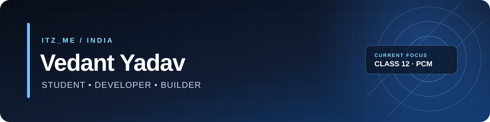
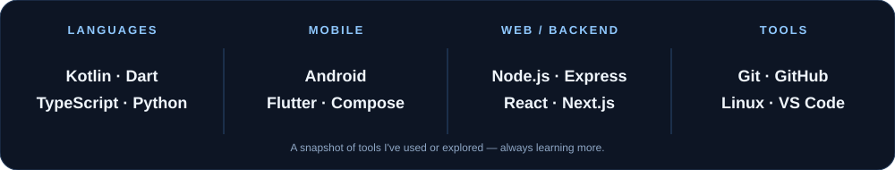
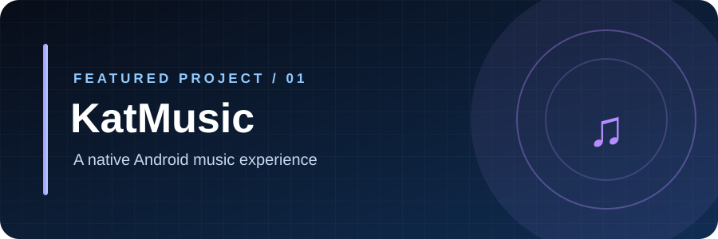
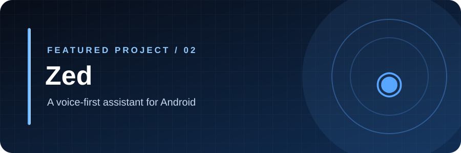
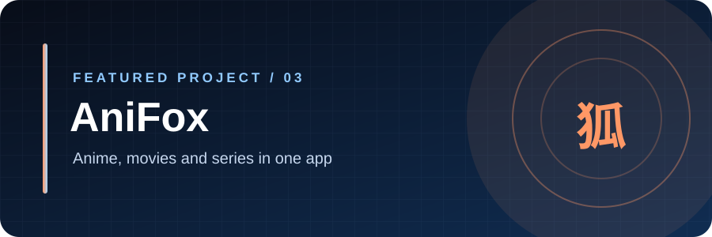
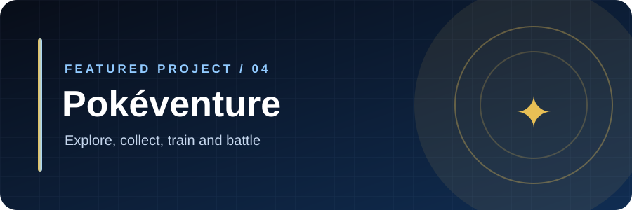
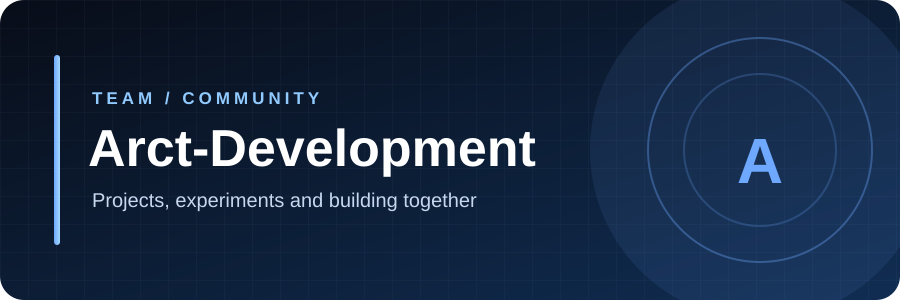

<!-- Profile: Itz_Me / ItzFallenMe. Artwork is self-hosted in /assets. -->

**Just a student who enjoys building apps, exploring technology, and learning by doing.**

## whoami

Hey! I'm **Itz_Me**, also known as **ItzFallenMe**.

I'm a **17-year-old Class 12 student (PCM)** from India. Outside academics, I enjoy coding, experimenting with ideas, and turning them into real projects.

- Currently balancing **Physics, Chemistry, Mathematics** and development.
- Building Android apps, web projects, utilities, and game-related experiments.
- Learning more about software design, backend systems, and practical AI integrations.
- I use AI tools where they help, but I'm still learning — definitely not claiming to be an AI expert.

> Small progress, consistent commits, better projects.

## what I use

## featured projects

A native Android client for YouTube Music, with offline downloads, word-by-word lyrics, a parametric equaliser, and an automix engine.

<b>Kotlin · Jetpack Compose · Android</b> | <a href="https://github.com/ItzFallenMe/KatMusic">Repository</a>

 

A voice-first Android phone assistant with a personality, built to understand requests and interact with the device.

<b>Android · Voice interaction · Assistant tools</b> | <a href="https://github.com/ItzFallenMe/Zed">Repository</a>

 

An Android entertainment app for discovering anime, movies, and series, with a personal library and playback features.

<b>Android · Media · App development</b> | <a href="https://github.com/ItzFallenMe/AniFox">Repository</a>

 

A mobile collection RPG inspired by Pokétwo, with Pokémon collection, training, exploration, and battles powered by the Pokémon Showdown simulator.

<b>Flutter · Dart · TypeScript · Node.js</b> | <a href="https://github.com/ItzFallenMe/Pokeventure">Repository</a>

## team

## github

 

**Thanks for visiting my profile!**

*Keep learning. Keep building. Keep improving.*

<a href="https://github.com/ItzFallenMe">Itz_Me / ItzFallenMe</a>

